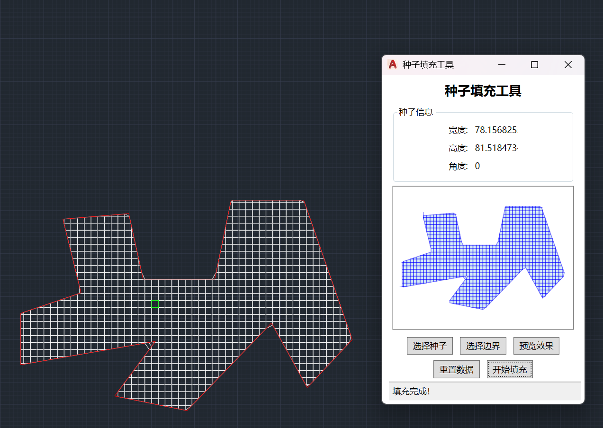

# BIMSeedFiller · AutoCAD 种子填充与几何计算插件

AutoCAD 二次开发插件：给定**种子图元**和**闭合边界**，自动在边界内铺排带旋转角度的矩形，并对压边图元做几何裁剪。

核心技术点：**计算几何（凸包 / 多边形裁剪）**、**AutoCAD .NET API 的事务与图元生命周期管理**、**WPF 面板与非模态窗口和 CAD 命令的消息循环共存**。



---

## 功能

1. **选种子**：拾取一个矩形图元作为"砖块"模板，可指定旋转角度与间距。
2. **选边界**：拾取闭合多段线（支持含圆弧的边界），作为填充范围。
3. **网格阵列生成**：按种子尺寸与角度推算覆盖边界的旋转网格。
4. **三态判定**：
   - 完全在边界外 → 剔除；
   - 完全在边界内 → 原样保留；
   - 压边 → 裁剪成 `ClippedTile`；
5. **边修剪 + 凸包重建**：压边裁剪后的顶点是乱序的，直接用会画出乱连线；用 **Andrew 单调链凸包**重排顶点，恢复正确的多边形轮廓。
6. **图层序管理**：结果按图层归置，避免与原有图元混层。
7. **状态栏统计**：实时显示已处理 / 保留 / 剔除 / 裁剪数量。

---

## 技术栈

| 项 | 选型 |
|---|---|
| 运行时 | .NET Framework 4.8 |
| 宿主 | AutoCAD 2022（.NET API：`AcDb` / `AcMgd`） |
| 界面 | WPF（非模态面板）+ MVVM |
| 几何 | 自研：旋转包围盒、射线法内外判定、边修剪、Andrew 单调链凸包 |

---

## 结构

```
BIMSeedFiller/
├─ BIMSeedFiller.Core/      算法与数据模型（不依赖 WPF）
│  ├─ TileFiller.cs         铺排 / 三态判定 / 裁剪 / 凸包（核心，800 行量级）
│  ├─ InputCollector.cs     种子与边界拾取、几何提取
│  └─ DataModel/            Tile / StandardTile / ClippedTile / SeedData / BoundaryData
├─ BIMSeedFiller.Wpf/       WPF 面板：ViewModel + Commands + 窗口
├─ BIMSeedFiller/           v1 单体版（保留对照，当前开发在 Core + Wpf）
├─ docs/                    实现思路文档（含数学推导与方案对比）
└─ images/                  界面截图
```

---

## 关键工程决策

### 为什么自研裁剪，而不是用 Region / MPolygon

对比过三条路：

| 方案 | 问题 |
|---|---|
| `Region` 布尔运算 | 每次布尔都要提交事务，上千块砖时开销大；且结果实体类型转换繁琐 |
| `MPolygon` | 对含圆弧边界与旋转矩形的组合支持有限，行为不易预测 |
| **边修剪 + 凸包重建（采用）** | 纯几何计算，不碰数据库；顶点顺序由凸包保证，不会出现乱线 |

### 事务与图元生命周期

- 所有读写都在 `Transaction` 内完成，提交前不落地；
- 需要对已存在图元做修改时用 `UpgradeOpen()`，避免 `eNotOpenForWrite`；
- 批量生成失败时保留已生成部分并回报统计，不做半途静默回滚。

### WPF 面板与 CAD 消息循环

非模态 WPF 面板在 AutoCAD 里会与命令的消息循环抢焦点，且跨窗口操作数据库会抛访问冲突。处理方式：

- 面板操作数据库时统一走 `Document.LockDocument()`（本仓库两处关键路径）；
- UI 线程与 CAD 线程之间用 `Dispatcher` 封送，不直接跨线程改图元；
- 焦点冲突在第 9 次提交（`9bda7ab`）中修复。

---

## 如何运行

1. 用 Visual Studio 打开 `BIMSeedFiller.sln`，以 **AutoCAD 2022** 的 `AcDbMgd.dll` / `AcMgd.dll` 为引用编译（目标框架 net48）。
2. 启动 AutoCAD 2022，命令行输入 `NETLOAD`，选择编译输出的 `BIMSeedFiller.Wpf.dll`。
3. 输入插件注册的命令，打开填充面板。
4. 先"选种子"，再"选边界"，点"开始填充"。

> 需要本机安装 AutoCAD 2022；其他版本需重新引用对应版本的 API 程序集并重编译。

---

## 交付物

- 可运行插件（编译产物）
- `docs/BIMSeedFiller_实现思路文档.pdf`：算法推导、方案对比、关键代码说明
- 演示视频与界面截图
- 完整源码（本仓库）

---

## 已知限制

1. **版本绑定**：只针对 AutoCAD 2022 / net48 编译验证，未做 R24 系列其他版本的兼容矩阵。
2. **无批量撤销**：一次填充生成大量图元，中途失败没有整体撤销（依赖 CAD 自身的 UNDO）。
3. **无性能数据**：单张图纸 10 万块砖级的耗时与裁剪占比未实测，只有功能验证。
4. **两套实现并存**：`BIMSeedFiller/` 是早期单体版，重构后的结构在 `BIMSeedFiller.Core` + `BIMSeedFiller.Wpf`，前者暂留作对照。
5. **无安装包**：通过 `NETLOAD` 手动加载，未做打包分发。

---

## License

个人项目，未指定开源协议；如需引用请先联系。
